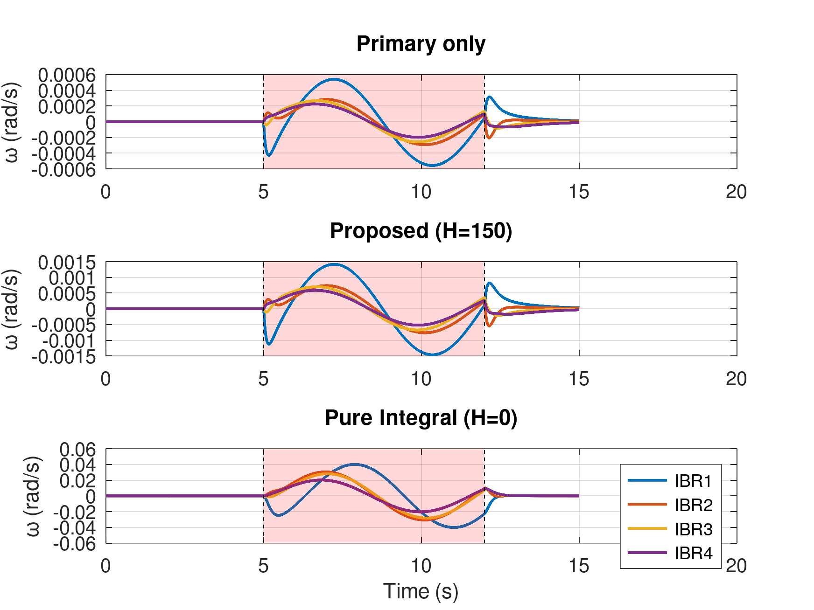
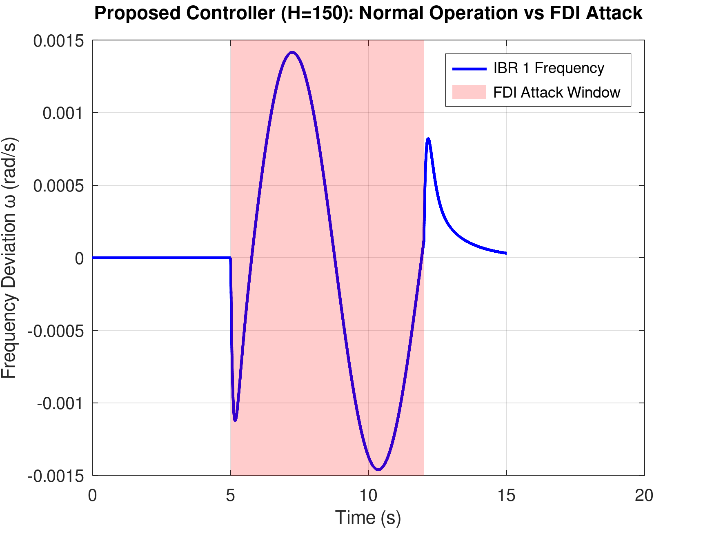
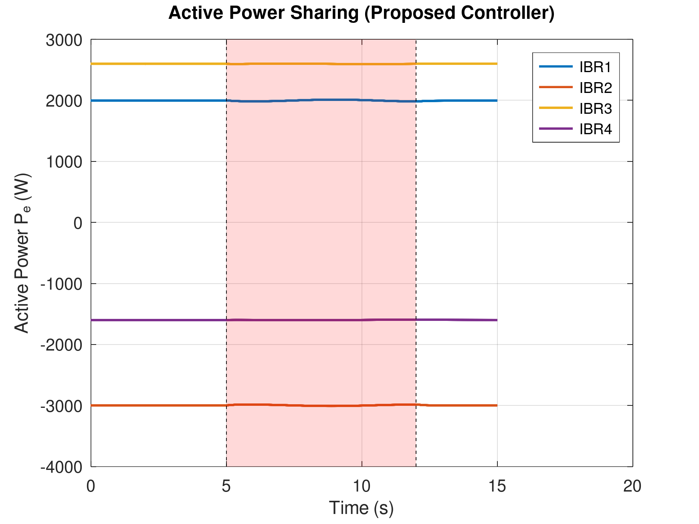
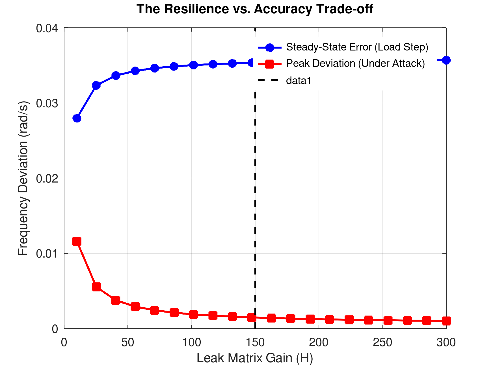

# Cyber-Resilient Secondary Frequency Control: Independent Stress-Test

Seminar project analysing a cyber-resilient secondary frequency control scheme for virtual-synchronous-generator (VSG) microgrids under false data injection (FDI) attacks. The paper is Jamali et al., IEEE TIE 2026. **All code and figures here are my own simulation, not reproductions of the paper's figures.**

## Model
4 grid-forming inverters (swing equation, M = 1000, D = 13880) on a 3-line network, with secondary control states and FDI signals injected on the control input and the controller state during t = 5-12 s.

Three controllers are compared:
- Primary only (no secondary control)
- Proposed leaky secondary control (beta = 100, H = 150)
- Pure integral (H = 0)

## Results
Max |w| in the final 0.5 s of a constant-bias attack (rad/s):

| Attack | Primary only | Proposed (H=150) | Pure integral (H=0) |
|---|---|---|---|
| delta_u only | 4.1e-4 | 4.1e-4 | ~0 |
| delta_xi only | ~0 | 6.8e-4 | 4.7e-2 |
| both | 4.1e-4 | 1.1e-3 | 4.7e-2 |

- The leak term H protects against `delta_xi` attacks: the pure integral controller is about 40x worse there.
- The price is accuracy: Fig 4 shows load-step steady-state error rising with H while peak attack deviation falls.
- Active power sharing stays essentially flat during the attack (Fig 3).

## Files
| File | What it is |
|---|---|
| `jamali_vsg_demo.m` | Main script: tables, load step, H-sweep, saves the four figures |
| `run_sim.m`, `rhs_func.m`, `params.m` | Simulation function, dynamics and parameters |
| `jamali_vsg_check.py` | Python/SciPy version of the same model for cross-checking |
| `seminar.tex`, `seminar.pdf`, `slides.md` | Seminar slides |

## Run
    octave --no-gui jamali_vsg_demo.m

Works in Octave or MATLAB. The paper's PDF is not included due to IEEE copyright.

## Author
Aayush, EEE @ NIT Goa
